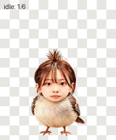
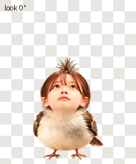
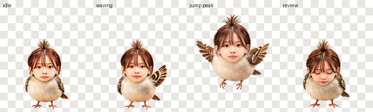
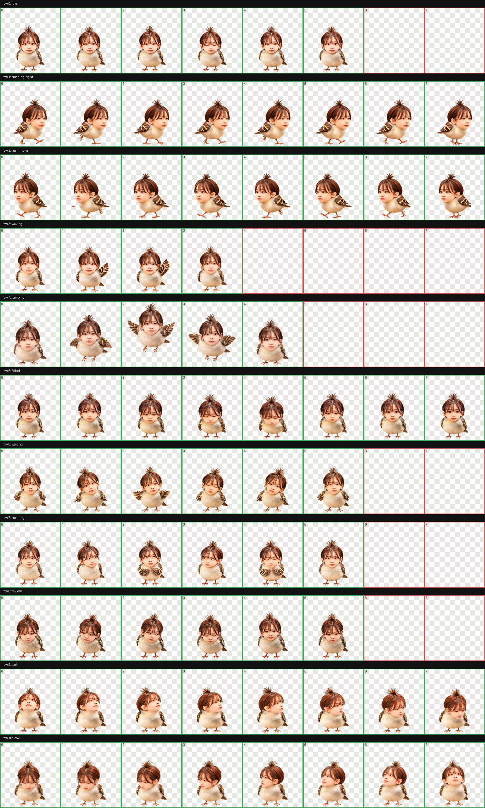

# 珉鸟 · Minniao

圆滚滚的人脸小鸟宠物：棕色刘海、头顶翘毛、灰褐色羽毛、短翅膀和小鸟脚。动画资源采用 Codex / ChatGPT Pets v2 精灵图格式。





## 动作预览

包含待机、向右移动、向左移动、挥翅、跳跃、失败反应、等待输入、工作思考、检查成果，以及十六个顺时针视线方向，共 73 帧。

待机行保留格式要求的 6 格，改为五格睁眼、一格闭眼，让半闭姿态不再停留。v2 固定 73 帧总数和 6 格待机行；宠物清单不支持逐帧时长，所以实际宠物的播放速度由 ChatGPT Pets 控制。预览 GIF 用 80 毫秒展示闭眼帧，其余睁眼帧停留更久，只用于展示眨眼节奏。





## 宠物包

`dist/minniao.codex-pet.zip` 内含 `pet.json` 和透明精灵图 `spritesheet.png`。清单中的 `displayName` 是「珉鸟」，精灵图为 v2 格式，适合需要 Codex Pets v2 资源包的导入流程。

## 重新生成预览

需要 Python 3.10 或更新版本。

```sh
python -m pip install -r requirements.txt
python scripts/validate_pet.py
python scripts/render_previews.py
```

渲染脚本从精灵图中裁出动画帧，生成各动作 GIF、视线循环、待机—跳跃—待机 GIF、完整动作 GIF/MP4、带标签的静帧和接触表。脚本不会重绘角色。接触表与帧间动画一起帮助检查动作和方向。

## 格式与复核

- 透明 PNG，1536 × 2288 像素。
- 8 列、11 行，每格 192 × 208 像素。
- 前九行动作帧数：6、8、8、4、5、8、6、6、6；最后两行视线帧各 8 帧。
- 未使用的 15 格完全透明。
- 上传前 Pets v2 结构验证和制作流程质量检查均通过。
- 跳跃最高离地 39 像素，落脚位置与待机相差 1 像素。

112.5°、247.5°、337.5° 的次要视线分量较轻微；复核确认主要方向清楚，并通过顺序循环检查过渡。详细信息见 [验证摘要](validation/summary.json)。仓库内的验证脚本检查格式、透明度、帧占用和边缘裁切；动作含义仍需结合预览进行视觉检查。

## 文件

- `assets/`：宠物描述与完整透明精灵图。
- `scripts/`：结构验证与预览生成代码。
- `previews/`：动作 GIF/MP4、视线循环、静帧和接触表。
- `dist/`：可下载的宠物资源包。
- `validation/`：公开验证摘要。

代码与本项目生成的宠物素材按 [MIT License](LICENSE) 提供。

